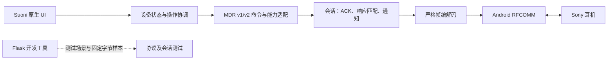

# Suoni APK 技术方案（讨论稿）

运行边界已于 2026-10-17 获用户确认；其余技术方案记录建议，需与 PRD 中用户决策一同收敛后再审批实现。

## 已确认运行边界

Kotlin 持有真实蓝牙连接和设备状态；Flask 仅服务开发、模拟、字节样本回放与回归。APK 的核心控制链路独立离线运行，不依赖 Flask、Sony App 或 Sony 账号，不把 Python 打包进 APK。若用户以后需要 Linux 中控，另行明确其蓝牙所有权、部署、权限、访问边界及与手机控制的关系，再重审架构。

Android 使用系统已配对设备和 RFCOMM 服务 UUID，通过 SDP 定位服务；不硬编码 channel 9。UUID 选择后仍以握手确认协议版本与支持功能。只有新增扫描时才设计扫描流程与相关权限；首版 Android 12+ 已配对控制使用运行时 BLUETOOTH_CONNECT，旧系统按实际 min/target SDK 验证权限。

## 代码边界与数据流

建议新源码使用 `android/` 和 `lab/`，共享脱敏样本放 `fixtures/mdr/`；这是候选布局，当前不创建产品目录。先用少量逻辑包划分职责，不预建大量 Gradle 模块。

1. 帧层：纯 Kotlin 字节处理；严格检查长度、校验、转义、序号、负载上限；流式输入支持分包/粘包与错误后重新同步。
2. 会话层：一个连接拥有一个读取循环；DATA 与 ACK 共用串行写入通道；ACK 立即处理，SHOT 独立分发；按命令表、响应类型和询问类型匹配请求，不能只匹配首字节。
3. 命令层：共享帧/会话，按握手选择 v1/v2 布局；能力来自功能列表、能力参数与必要的 GET_PARAM 验证。未知功能保留为 unsupported/unknown。
4. 设备协调层：一个活动目标、一个会话；连接/协商/就绪/断开/错误独立建模。UI 和将来的磁贴共用它。阻塞 I/O 离开主线程，取消时关闭 socket；重连有界。
5. UI：建议 Kotlin + Compose，具体技术/视觉待确认。设备选择、日常控制、诊断信息为逻辑入口，不要求三个独立页面。状态通过可观察数据单向驱动；加载、权限拒绝、断线、不支持、写入待确认均明确呈现。

操作路径：用户选择绝对目标值 → 检查能力/范围 → 读取需保留字段 → 修改所选字段 → 写入 → 匹配响应/通知或回读 → 更新已确认状态。ACK 只表示传输接收。连接失败后的业务写入不自动重放，尤其不重放模式循环/切歌等相对操作。

通知在无请求时也需更新状态；断连清除会话有效性，缓存标记为旧值。首次切换目标不自动修改设备设置，不以设备列表第一项代替用户选择。首版建议前台连接，进入后台可释放、返回时重新读取；后台常驻与磁贴生命周期另阶段验收。

## Flask 开发工具职责

实验工具提供受控设备场景、支持/不支持能力、超时/断连/通知时序以及固定协议字节，辅助持续回归。测试框架通过同一套样本和可注入 transport 验证 Kotlin 会话；HTTP 工具不是虚拟 RFCOMM 耳机，也不能证明真机蓝牙正确。开发工具的具体 HTTP 路由、数据结构和启动方式随最终方案细化，不先建立数据库或远程控制端点。

## 分阶段功能扩展

首版建议连接、电量、NC/ASM。之后候选为 EQ 预设/自定义、DSEE/音质模式、播放/音量，再评估快捷磁贴和多设备管理。

配对列表/多点切换不能从某一条 PERI 命令推导通用支持：资料中 WF-1000XM4 不支持相应功能，WF-1000XM6 的相关功能走另一条能力路径。v1 音量也不能套用 v2 MDR 写入；Android 系统音量为独立方案。

## 兼容、风险与退出点

- 候选设备是 WF-1000XM4、WF-1000XM6、WH-1000XM4；首版只承诺最终选定并完成真机验收的组合。
- Sony App 与 Suoni 可能争用控制链路；需区分单独控制成功和两者共存验证。失败须可恢复，不能强制退出其他 App。
- 基于行为证据独立实现；原 APK、图标及反编译代码不打包。若要直接复用原型源码，先解决来源/许可证据。
- 原型 SDK/AGP/Kotlin 版本不是新工程版本建议；实现前查询官方兼容表，固定 wrapper/toolchain，并完成 Docker 开发环境检查。
- 每一阶段先读状态再开放写入；不发固件/恢复出厂/取消配对命令。失败时保留 archive 和实验记录，可退回只读诊断。

## 官方技术依据

2026-10-17 查阅：[Android RFCOMM 连接](https://developer.android.com/develop/connectivity/bluetooth/connect-bluetooth-devices)（UUID/SDP、阻塞连接、线程与关闭）；[Android 蓝牙权限](https://developer.android.com/develop/connectivity/bluetooth/bt-permissions)（已配对控制与扫描权限不同）。当前尚未选择新版构建工具版本。
